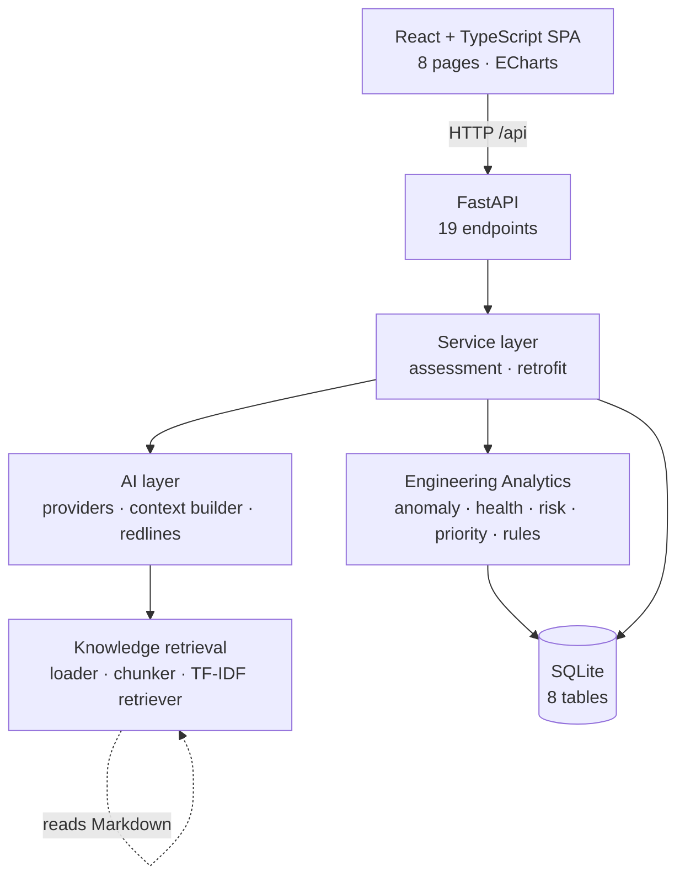
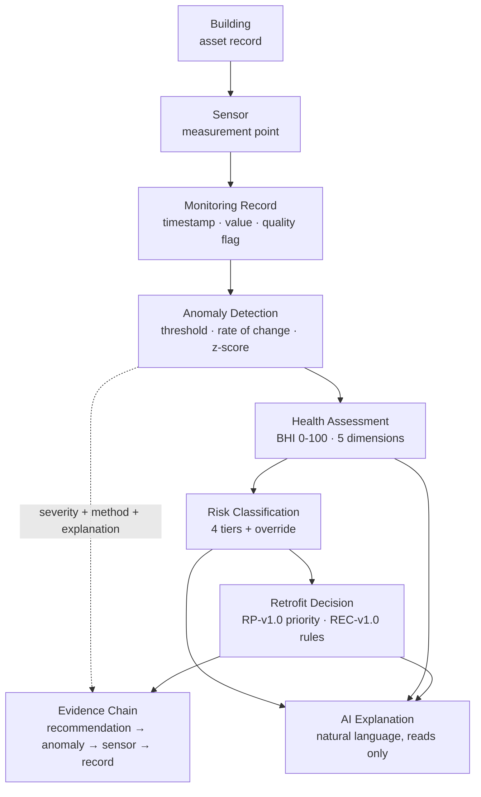
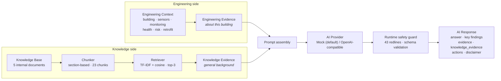
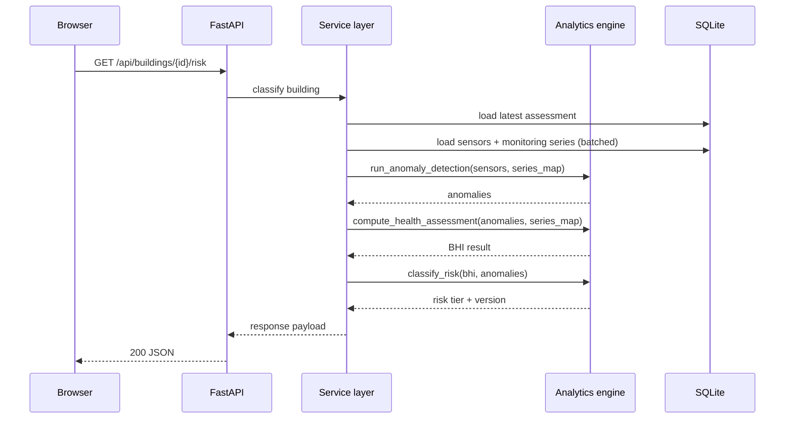
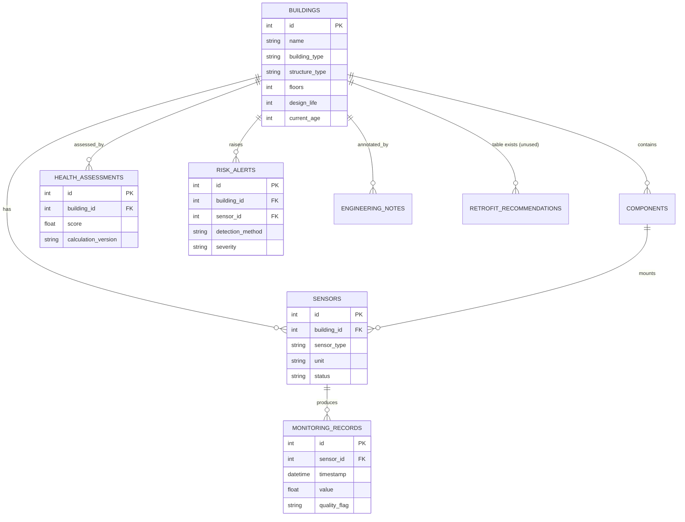
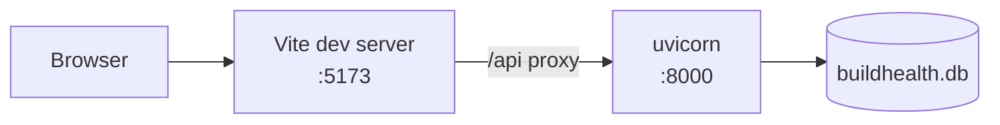

# BuildHealth Architecture

> System structure and data flow. Diagrams render on GitHub and in any
> Mermaid-capable viewer.
>
> Diagrams describe the current implementation. See
> `28_Project_Fact_Sheet.md` for the verified fact baseline.

---

## 1. System layers

The analytics engine does not depend on the API layer, and the AI layer does not
depend on the analytics internals — it reads a typed engineering context that
the service layer builds. This keeps the deterministic computation independent
of both the transport and the explanation layer.

---

## 2. Engineering data flow

Each layer carries a version identifier (`ANOM-v1.0`, `BHI-v1.0`, `RISK-v1.0`,
`RP-v1.0`, `REC-v1.0`, `AI-v1.0`) so a stored or displayed result can be
interpreted against the parameters that produced it.

---

## 3. AI and retrieval

### Engineering Evidence ≠ Knowledge Evidence

The two are kept apart at every layer:

| | Engineering Evidence | Knowledge Evidence |
|---|---|---|
| **Meaning** | Measurements and derived results **about this building** | General engineering concepts, **not about this building** |
| **Source** | Sensors, monitoring records, anomalies, BHI, risk, retrofit | The internal knowledge base |
| **Priority** | Absolute — it is the basis of the response | Background explanation only |
| **Schema** | `AIResponse.evidence` | `AIResponse.knowledge_evidence` |
| **Prompt key** | `engineering_data_context` | `knowledge_evidence` |
| **UI** | Evidence section | Knowledge Sources section (distinct colour) |
| **Can it prove a condition in this building?** | Yes | **No** |

The system prompt states that engineering data has absolute priority, and the
knowledge context is declared untrusted. The retrieved knowledge evidence is
forced from the retriever — anything the model returns for that field is
discarded.

---

## 4. Request lifecycle (read path)

For paths that need several of these results (the AI context build, the
aggregate endpoints), a request-scoped analysis object is computed **once per
building** and passed down the call stack, so no layer recomputes what an
earlier layer already produced.

---

## 5. Data model

Eight tables in total. `retrofit_recommendations` exists in the schema but is
not currently written to — recommendations are computed in real time.

---

## 6. Deployment shape (current)

Single machine, local development only. No cloud deployment, no authentication,
no rate limiting. CORS is restricted to local development origins.
